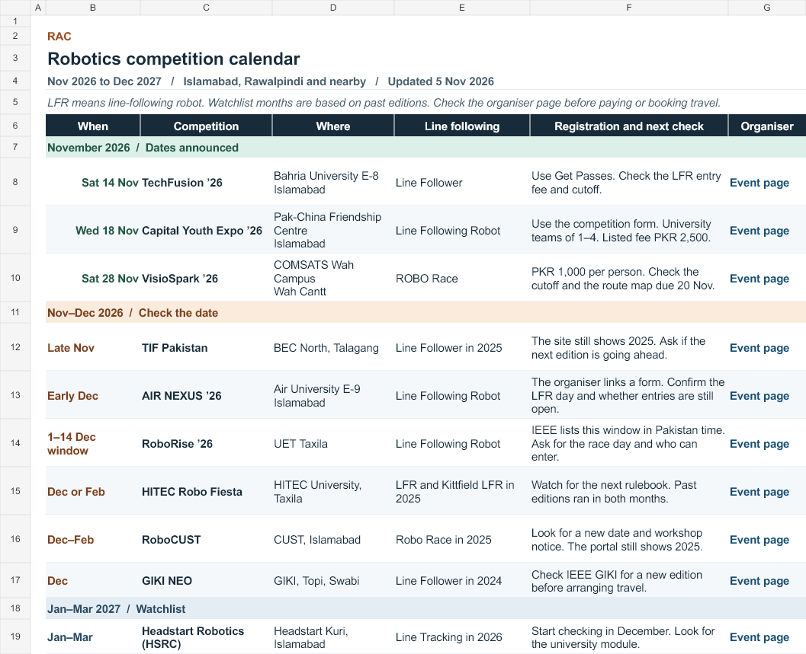

# Pakistan Robotics Competition Calendar

A RAC guide for finding student robotics competitions. It focuses on line following (LFR) in Islamabad, Rawalpindi and nearby cities, with selected events farther afield. It also records sumo, RoboWar, maze, drone and project categories when the sources list them.

**Start with the [2026–27 schedule workbook](calendar/RAC%20Robotics%20Calendar%202026-27.xlsx).** Its first tab has the date, venue, registration note and organiser link. The other tabs cover event categories, past editions and LFR rules. The schedule is a snapshot updated **5 Nov 2026**. Watchlist windows are estimates based on past editions.

- [Schedule CSV](data/schedule.csv) for filtering, reuse or review in GitHub.
- [Research archive](archive/README.md) for the original workbook layout and the five PDFs shared with RAC juniors.
- [Releases](https://github.com/MuhammadIsmail0331/pakistan-robotics-competition-calendar/releases) for the Excel and PDF downloads.

For a correction or new event, open an issue with the edition, event date, city, eligible teams, category and an organiser link. Include the registration deadline when the host has published it. The workbook and CSV should be updated together.

See the [McLaren sumobot project](https://github.com/MuhammadIsmail0331/mclaren-6wd-sumobot) for a separate RAC chassis project.
